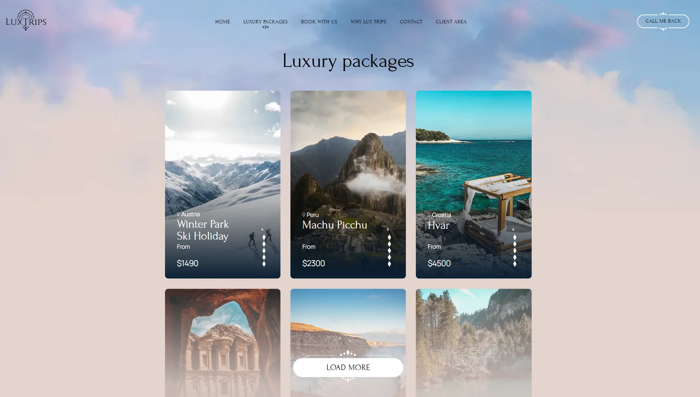
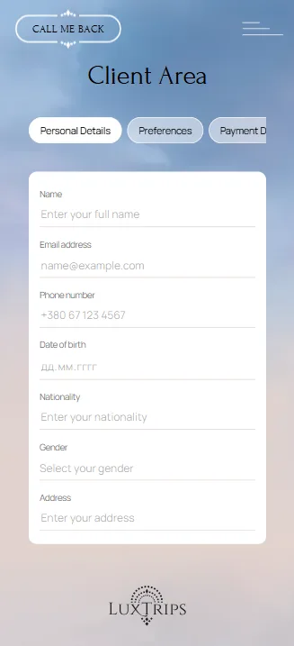

# Lux Trips
 
A multi-page website for a luxury travel agency, with smooth scrolling, scroll-driven animations and fully working forms.
 
**Live demo:** [lux-trips-eight.vercel.app](https://lux-trips-eight.vercel.app)
 

 
## Features
 
- **Smooth scrolling and scroll animations.** Lenis runs on the GSAP ticker in a single animation loop, so ScrollTrigger and the scroll position never drift apart. Parallax hero, text revealed line by line with SplitText, decorative layers that move with the scroll.
- **8 pages with client-side routing:** Home, Luxury Packages, Book With Us, Why Lux Trips, Contact, Client Area, Trip Request, 404.
- **Forms with real validation** (React Hook Form):
  - trip request: date range checks, guest count limits, success dialog with a summary of the request;
  - newsletter subscription with accessible error and success states;
  - Client Area: phone and email validation, date picker, select fields.
- **Packages catalogue** loaded from JSON through a Zustand store, with skeleton placeholders and a "Load more" button.
- **Responsive layout** from 320px to wide desktops, including a mobile tab strip in the Client Area.
- **Accessibility:** semantic landmarks and headings, keyboard navigation for tabs (arrow keys, Home/End), `aria-invalid` and `aria-describedby` on form errors, native `<dialog>` for modals.
## Tech stack
 
| Area | Tools |
| --- | --- |
| UI | React 19, React Router 7 |
| Animation | GSAP 3 (ScrollTrigger, SplitText), `@gsap/react`, Lenis, Motion |
| State | Zustand |
| Forms | React Hook Form |
| Slider | Swiper |
| Styles | SCSS (BEM), fluid typography, PostCSS pxtorem |
| Build | Vite 6 |
| Hosting | Vercel |
 
## Performance work
 
The site is image-heavy and animation-heavy, so a large part of the work went into keeping it fast and smooth, especially on phones.
 
| Problem | Fix | Result |
| --- | --- | --- |
| 43.5 MB of PNG images | A Node script (`scripts/convert-images.mjs`, using sharp) converts every image to WebP and rewrites the paths in the code | **3.9 MB**, 11× smaller |
| Hero layers appeared one by one on load | WebP layers + `<link rel="preload" fetchpriority="high">` | Hero renders at once |
| Jerky scrolling | Removed a duplicate requestAnimationFrame loop; Lenis now runs on `gsap.ticker` | One frame loop, smooth scroll |
| Scroll stopped working after page transitions | Added `lenis.css`, so Lenis notices when the page gets taller | Scroll works on every route |
| Stutter on mobile in animated sections | Decorative elements are animated with `transform` instead of rewriting CSS rules (CSSRulePlugin) | No style recalculation on every scroll frame |
| Header re-rendered on every scroll frame | Stores only a "scrolled" flag, so React re-renders twice instead of 60 times per second | Lighter scrolling on every page |
| ScrollTrigger recalculated when the mobile address bar hid | `ScrollTrigger.config({ ignoreMobileResize: true })` | No jumps on mobile |
 
## Getting started
 
Requires Node.js 20 or newer.
 
```bash
git clone https://github.com/AtremLysuk/Lux-Trips.git
cd Lux-Trips
npm install
npm run dev
```
 
| Command | What it does |
| --- | --- |
| `npm run dev` | Start the dev server |
| `npm run build` | Production build into `dist/` |
| `npm run preview` | Serve the production build locally |
| `npm run lint` | Run ESLint |
| `node scripts/convert-images.mjs` | Convert new PNG/JPG images in `public/` to WebP and update their paths |
 
## Project structure
 
```
src/
├── pages/        # route-level pages
├── sections/     # large page sections (Hero, Trips, Customize, …)
├── components/   # reusable UI: forms, cards, header, footer, slider
├── Hooks/        # custom hooks (Lenis + ScrollTrigger integration)
├── zustand/      # stores
├── constants/    # shared constants (validation patterns)
├── utils/        # helpers
└── scss/         # variables, mixins, BEM blocks
public/
├── images/       # WebP images
└── data.json     # packages catalogue
scripts/
└── convert-images.mjs
```
 
## Screenshots
 
| Luxury packages | Client Area (mobile) |
| --- | --- |
|  |  |
 
## Author
 
**Artem Lysiuk**, frontend developer
[GitHub](https://github.com/AtremLysuk)